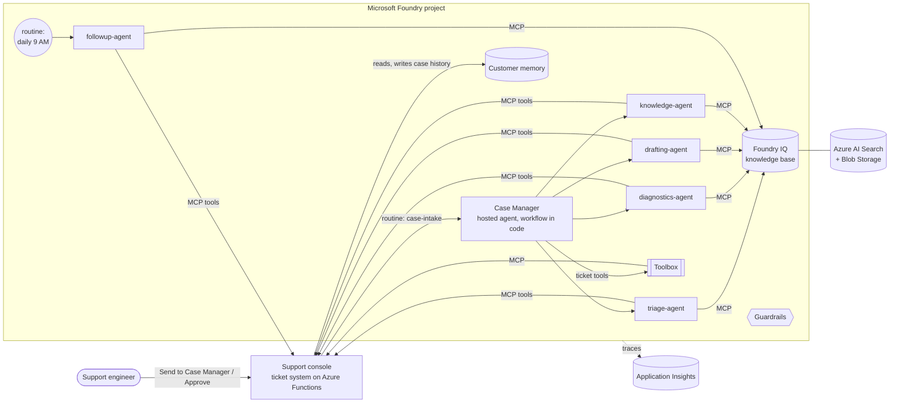

<p align="center">

</p>

# [Microsoft Ignite 2026](https://ignite.microsoft.com)

## 🔥LTG1185: Build an AI customer support agent with Microsoft Foundry

### Session description

Build a multi-agent customer support system with Microsoft Foundry that triages tickets, analyzes logs, finds the fix in your knowledge base, and drafts the customer reply, then waits for a support engineer to approve it. This repo is the complete sample from the session: one `azd up` deploys it to your Azure subscription, including a mock ticket system with a web console, so you can try it in about 30 minutes and then connect your own ticket system.

### 🚀 Getting started

#### In a guided session

If you watched the session and want to see the same demo in your own subscription:

1. Check the [prerequisites](#prerequisites), then run `azd up` as shown in [Deploy](#deploy).
2. Open the support console URL that `azd up` prints, select ticket **TCK-1042**, and select **Send to Case Manager**.
3. Review the draft and approve it, then open the run, its trace, and the customer memory in the [Foundry portal](https://ai.azure.com).

#### On your own

If you're learning at your own pace:

1. Clone this repository and deploy it with `azd up` (see [Quick start](#quick-start)).
2. Try the tickets in [Try it](#try-it), then [run the evaluations](#run-the-evaluations).
3. Follow the [portal walkthrough](instructions/portal-walkthrough.md) to build the same system click by click, and read the [architecture guide](docs/architecture.md) to see how the pieces fit.

### 🎯 Learning outcomes

By the end of this session, you will be able to:

- Break a support workflow into focused Foundry prompt agents, coordinated by a hosted agent whose code enforces a human approval step.
- Connect agents to your own systems and knowledge with MCP tools, Toolbox, Foundry IQ, and Memory.
- Check that your agents can be trusted with guardrails, tracing, and evaluations, including a custom "Would you send this?" judge.

### 💻 Technologies used

- Microsoft Foundry: prompt agents, hosted agents, Toolbox, Foundry IQ, Memory, routines, guardrails, tracing, and evaluations
- Microsoft Agent Framework (Python)
- Model Context Protocol (MCP)
- Azure Functions, Azure AI Search, Azure Blob Storage, and Application Insights
- Azure Developer CLI (`azd`) and Bicep

### How it works

A working, multi-agent customer support system for a fictional SaaS product, **Contoso OrderSync**. A ticket arrives, and a team of agents triages it, reads the logs, finds the fix in the knowledge base, and drafts a reply in the customer's preferred style. Then it stops and waits. **Nothing reaches the customer until a support engineer approves it.**


Open the support console, pick ticket **TCK-1042** (a Premier customer whose orders stopped syncing before a big sale), and select **Send to Case Manager**. About two minutes later:

1. **Triage** sets the severity from the support policy (KB-107) and pulls up what we know about the customer from memory (read-only, through the ticket system, and only this customer's scope): Dana prefers short bullet points and had a similar incident last quarter.
2. **Diagnostics** runs Python over the attached logs with Code Interpreter, charts the error spike, and matches the error to a known issue (KB-104).
3. **Drafting** writes the customer email: plain-language cause, both fix options, and a next-update time computed from the response target, in bullets, because that's how Dana likes it.
4. The **Case Manager** saves the draft on the ticket and stops. You read it in the console and approve it, edit it, ask for changes, or decline. Only an approval sends it.

Other tickets take other routes. **TCK-1045** is vague and has no logs, so the agents ask the customer for exactly what's missing instead of guessing. A new problem that no KB article covers is escalated to an engineer, and a **knowledge agent** drafts the missing article for review.

#### Foundry features in this sample

Each piece of the system maps to a Foundry capability. The [architecture guide](docs/architecture.md) goes deeper on each.
### Quick start

### Prerequisites

- An Azure subscription where you can create resource groups and **assign roles** (Owner, or Contributor + User Access Administrator).
- [Azure Developer CLI](https://aka.ms/azd-install) **1.37 or later**. `azd` installs the Foundry extensions it needs on first run.
- [Python 3.11+](https://www.python.org/downloads/) for the setup script.
- Model quota in your region (see [Regions and quota](#regions-and-quota)).

### Deploy

```bash
git clone https://github.com/microsoft/ignite26-ltg1185
cd ignite26-ltg1185
azd auth login
azd up
```

`azd up` asks for an environment name, a subscription, and a region, then:

1. **Provisions** (Bicep, 10 to 20 minutes): Foundry account and project, three model deployments, the guardrail policy, Azure AI Search, Storage, the ticket system's Function App, Application Insights, and every role assignment, all keyless with managed identities.
2. **Deploys** the ticket system to Azure Functions and the Case Manager as a hosted agent (Foundry builds the container for you).
3. **Configures** Foundry with [scripts/setup.py](scripts/setup.py): uploads and indexes the knowledge base, creates the MCP connections, memory store, toolbox, the five prompt agents, the routines, and loads the demo tickets.

When it finishes, it prints the **support console** URL. Open it and send **TCK-1042** to the Case Manager.

> The script is safe to re-run. It only creates new agent versions when an agent's definition changed.

### Try it

| Ticket | What happens |
|---|---|
| **TCK-1042** | Full path: triage with customer memory, log analysis with a chart, KB match (KB-104), and a bulleted email with both fix options, ready for approval. |
| **TCK-1043** | Admin sign-in failures: matched to the expired SSO signing certificate article (KB-102). |
| **TCK-1044** | Slow daily report: matched to the missing database index article (KB-106). |
| **TCK-1045** | Vague, no logs: the draft asks for exactly what's missing and links the customer log guide (KB-109). |
| **New ticket** | Select **New ticket** in the console and pick an example, or write your own. The "Order totals off by 1 yen" example has no KB match, so it's escalated to an engineer with a draft KB article attached for review. |

In the console, **Approve and send** sends the email, **Edit** lets you change it first, **Ask for changes** sends your guidance back to the drafting agent, and **Don't send** keeps it as a draft. Then open the [Foundry portal](https://ai.azure.com), go to your project, and look at the routine's run history, the trace for the run, and the customer memory.

To start fresh (reload the tickets and reset customer memory):

```bash
python scripts/reset_demo.py          # reset only
python scripts/reset_demo.py --run    # reset, then send every New ticket to the Case Manager
```

### Run the evaluations

```bash
python evals/run_evals.py drafting    # "Would you send this?" + groundedness + indirect attack
python evals/run_evals.py triage      # severity accuracy
```

See [docs/evaluations.md](docs/evaluations.md) for what each evaluator checks and how to read the results.

### Make it yours

- **Connect your own ticket system.** The agents only see MCP tools, so replacing the mock is mostly about exposing the same eight tools from ServiceNow, Zendesk, Dynamics 365, or your own system. Then you load your knowledge, fit the prompts to your product, and match your ID formats. See the checklist in [docs/bring-your-own-ticket-system.md](docs/bring-your-own-ticket-system.md).
- **Use your own knowledge base.** Replace the files in [knowledge-base/](knowledge-base/) and run `azd deploy` again; the setup script re-indexes them.
- **Change how an agent behaves.** Edit its `instructions.md` under [agents/](agents/) and run `azd deploy`, or edit it in the portal and publish a new version. Then run the evals to compare versions.
- **Do it by hand.** [instructions/portal-walkthrough.md](instructions/portal-walkthrough.md) builds the same system click by click in the Foundry portal, which is the best way to learn what each piece does.

### Repository layout

```
agents/              Prompt agent definitions: agent.json (model, tools, guardrail) + instructions.md
docs/                Architecture, bring your own ticket system, security, evals, troubleshooting
evals/               Eval datasets, the custom "Would you send this?" evaluator, and the eval runner
instructions/        Portal walkthrough: build the same system click by click
infra/               Bicep for every Azure resource and role assignment
knowledge-base/      The nine KB articles that Foundry IQ indexes
scripts/             Post-deploy setup (setup.py) and demo reset
src/case-manager/    The hosted Case Manager agent (Agent Framework workflow)
src/ticket-system/   Mock ticket system: Azure Functions with MCP tools and the support console
tests/               Unit tests for the ticket system, the Case Manager's policy code, and the templates
```

To run the unit tests locally (no Azure needed):

```bash
pip install -r src/case-manager/requirements.txt -r src/ticket-system/requirements.txt -r scripts/requirements.txt -r tests/requirements.txt
pytest tests -q
```

### Regions and quota

The defaults deploy to the region you choose with these models:

| Deployment | Model | SKU | Capacity (K TPM) |
|---|---|---|---|
| `gpt-5-mini` | gpt-5-mini (2025-08-07) | GlobalStandard | 100 |
| `gpt-5.4-mini` | gpt-5.4-mini (2026-03-17) | DataZoneStandard | 50 |
| `text-embedding-3-small` | text-embedding-3-small (1) | GlobalStandard | 100 |

`gpt-5.4-mini` runs the triage agent and is also the evaluation judge. **East US 2** and **Sweden Central** are good choices. If Azure AI Search is out of capacity in your region, put it elsewhere:

```bash
azd env set AZURE_SEARCH_LOCATION centralus
```

### Cost and cleanup

The sample runs on consumption pricing except for **Azure AI Search Basic** (about US$75 per month) and one **always-ready Functions instance** that keeps the console fast. To drop the always-ready instance, run `azd env set FUNCTION_ALWAYS_READY 0` and `azd provision`. Models are billed per token.

When you're done:

```bash
azd down --purge
```

`--purge` also deletes the soft-deleted Foundry account so you can reuse the name and quota.

### Learn more

- [Architecture](docs/architecture.md): how the pieces fit, and why the orchestration is code
- [Security and production readiness](docs/security-and-production.md)
- [Troubleshooting](docs/troubleshooting.md)
- [Microsoft Foundry documentation](https://learn.microsoft.com/azure/ai-foundry/)
- [Foundry hosted agents](https://learn.microsoft.com/azure/ai-foundry/agents/concepts/hosted-agents)

### 📚 Continue your learning

Pick your next step based on your learning style:

| Resource | What you'll get |
|----------|-----------------|
| **[Ignite 2026 Next Steps](https://aka.ms/ignite26-next-steps)** | Additional session repos and materials from Microsoft Ignite 2026 |
| **[Microsoft AI Skills Navigator](https://aka.ms/ignite26-asn)** | Discover AI skills, learning paths, and resources for your next step |
| **[Microsoft Learn](https://aka.ms/ignite26-learn)** | Official documentation and guided learning paths on these topics |
| **[Microsoft Foundry Community](https://aka.ms/MicrosoftFoundryDiscord-Ignite26)** | Connect with other learners and experts in our Discord community |

### 🌟 Microsoft Learn MCP Server

<!-- Remove this section if the Microsoft Learn MCP Server is not relevant to the session. -->

The Microsoft Learn MCP Server gives your AI agent direct access to Microsoft's official documentation — grounded, up-to-date answers about the topics in this session.

**GitHub Copilot CLI** — Install with:

```shell
copilot plugin install microsoftdocs/mcp
```

**VS Code** — One-click install:  
[](https://vscode.dev/redirect/mcp/install?name=microsoft-learn&config=%7B%22type%22%3A%22http%22%2C%22url%22%3A%22https%3A%2F%2Flearn.microsoft.com%2Fapi%2Fmcp%22%7D)

For more information, visit the [Learn MCP Server repo](https://aka.ms/learnmcp).

### 👥 Content owners

<table>
<tr>
    <td align="center"><a href="http://github.com/KyleMonteagudo">
        <br />
        <sub><b>Kyle Monteagudo</b></sub></a><br />
            <a href="https://github.com/KyleMonteagudo" title="talk">📢</a>
    </td>
</tr></table>
### ⚖️ Trademarks

This project may contain trademarks or logos for projects, products, or services. Authorized use of Microsoft trademarks or logos is subject to and must follow [Microsoft's Trademark & Brand Guidelines](https://www.microsoft.com/legal/intellectualproperty/trademarks/usage/general). Use of Microsoft trademarks or logos in modified versions of this project must not cause confusion or imply Microsoft sponsorship.

Any use of third-party trademarks or logos are subject to those third-party's policies.
