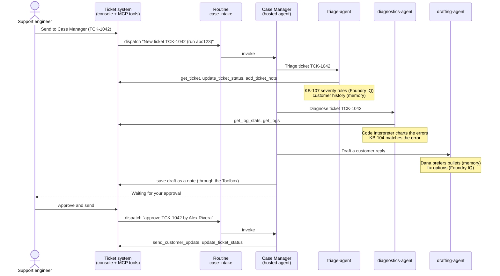

# Architecture

This sample is a support team where the agents do the legwork and a person makes the call. This page explains each piece, why it's built the way it is, and which Foundry feature carries it.

- [The flow of one ticket](#the-flow-of-one-ticket)
- [The Case Manager (hosted agent)](#the-case-manager-hosted-agent)
- [The specialists (prompt agents)](#the-specialists-prompt-agents)
- [Tools: MCP and the Toolbox](#tools-mcp-and-the-toolbox)
- [Knowledge: Foundry IQ](#knowledge-foundry-iq)
- [Memory](#memory)
- [Guardrails](#guardrails)
- [Routines](#routines)
- [Tracing](#tracing)
- [Identity and access](#identity-and-access)
- [The mock ticket system](#the-mock-ticket-system)

## The flow of one ticket



The Case Manager decides the route from facts, not from a model's opinion:

| Facts | Route |
|---|---|
| Logs attached, a KB article matches with good confidence | triage → diagnostics → drafting (fix options) → approval |
| No logs | triage → drafting (ask for what's missing, link the customer log guide KB-109) → approval |
| Logs, but no KB match or low confidence | triage → diagnostics → knowledge (draft a KB article, escalate) → drafting (escalation update) → approval |
| Engineer asks for changes | revise → drafting (with the engineer's guidance) → approval |
| Engineer approves | send the saved draft (or the engineer's edited version), set the status |

## The Case Manager (hosted agent)

[src/case-manager/main.py](../src/case-manager/main.py)

The Case Manager is ordinary Python: a [Microsoft Agent Framework](https://learn.microsoft.com/agent-framework/) workflow with one executor per step and edges that carry conditions. Foundry runs it as a **hosted agent**: `azd deploy` uploads the source, Foundry builds the container, gives it an Entra identity, scales it, and exposes it through the same Responses API as any other agent. You don't manage a container registry, a web server, or an identity.

**Why code and not a "manager" prompt agent?** Because some decisions shouldn't depend on how a model feels today:

- **The approval gate is a step in the graph.** The workflow always ends at `ApprovalGate`, which saves the draft and stops. Sending happens only in `DecisionStep`, which only runs for an `approve` message. No prompt can talk its way past an edge that doesn't exist.
- **Routing comes from facts.** "Are logs attached?" is a field on the ticket. "Did diagnostics match a KB article with good confidence?" is parsed from the diagnostics report (`needs_escalation`).
- **Policy that must always hold lives in code.** The next-update time comes from the response targets in KB-107, computed by `update_due` and enforced by `enforce_due`, so a customer is never promised a time the policy doesn't allow. Internal KB numbers are stripped from the email body by `tidy_draft`. The approving engineer's name is signed by `sign`. All of these have unit tests in [tests/case_manager](../tests/case_manager/).

The models do what they're good at: reading a ticket, reasoning over logs, finding the right article, and writing an email a person would want to receive.

**Resilience.** Each step retries transient Foundry errors (408, 429, 5xx) with backoff, and every agent and tool call has a timeout so a hung call becomes a retry instead of a silent stall. Each run carries a token; if the engineer restarts a run, the older one notices it's been replaced and stops without writing. If a run gives up, it leaves a `[Run stopped]` note and the ticket system's watchdog restarts it (up to twice).

**Versions.** The Case Manager calls each specialist by name. By default it uses the latest published version (checked every five minutes), so an improvement published in the portal is live within minutes. In production, pin versions so nothing changes until you choose:

```bash
azd env set DRAFTING_AGENT_VERSION 4
azd deploy case-manager
```

## The specialists (prompt agents)

[agents/](../agents/)

Each specialist is a **prompt agent**: a model deployment, instructions, and a set of tools, saved as an immutable version in Foundry. You can open any of them in the portal playground, change the instructions, and publish a new version without touching code.

| Agent | Model | Job | Tools |
|---|---|---|---|
| `triage-agent` | gpt-5.4-mini | Sets severity from KB-107, checks the customer's history | ticket system (get, status, note, customer memory), knowledge base |
| `diagnostics-agent` | gpt-5-mini | Analyzes logs with Python, charts the spike, matches a KB article | ticket system (log stats, logs, note), knowledge base, Code Interpreter |
| `drafting-agent` | gpt-5-mini | Writes the customer email in the contact's preferred style | ticket system (get, customer memory), knowledge base |
| `knowledge-agent` | gpt-5-mini | When no article matches, drafts a new one for review | ticket system (get, log stats), knowledge base |
| `followup-agent` | gpt-5-mini | Daily check of tickets waiting on the customer or overdue | ticket system (list, get, note), knowledge base |

`agent.json` holds the model, tools, and guardrail; `instructions.md` holds the instructions. The setup script fills in the deployment-specific values (`${CHAT_MODEL_DEPLOYMENT}`, the MCP URLs, the guardrail ID) and creates a new version only when something changed.

**Least privilege for tools.** Each agent's MCP tool lists exactly the ticket-system tools it may call (`allowed_tools`). No prompt agent has `send_customer_update`; only the Case Manager sends, and only after an approval.

## Tools: MCP and the Toolbox

**MCP.** The ticket system exposes eight tools over the [Model Context Protocol](https://modelcontextprotocol.io/), using the Azure Functions MCP extension:

| Tool | Used by |
|---|---|
| `get_ticket` | triage, drafting, knowledge, follow-up, Case Manager |
| `get_logs`, `get_log_stats` | diagnostics, knowledge |
| `add_ticket_note` | triage, diagnostics, follow-up, Case Manager |
| `update_ticket_status` | triage, Case Manager |
| `list_open_tickets` | follow-up |
| `send_customer_update` | Case Manager only, after approval |
| `attach_file` | Case Manager (charts, draft KB articles) |

Agents reach MCP servers through **project connections**. The `ticket-system` connection stores the Functions key, so it never appears in an agent definition or in code. The `support-kb` connection uses the project's managed identity, so there's no key at all.

**Toolbox.** A Toolbox is a named, versioned bundle of tools served from one MCP endpoint, authenticated with Entra ID. `support-toolbox` bundles the ticket-system MCP server, the Foundry IQ knowledge base, and Code Interpreter. The Case Manager connects to the toolbox endpoint (`TOOLBOX_ENDPOINT`) for every ticket-system call it makes in code (saving drafts, attaching charts, sending approved emails). Tool names are prefixed with the server label, for example `ticket-system___get_ticket`.

Why it matters: your code holds one URL and uses its own identity. Which servers are behind it, their credentials, and which version is live are managed in Foundry. To change tools, publish a new toolbox version and make it the default; the code doesn't change.

## Knowledge: Foundry IQ

[knowledge-base/](../knowledge-base/)

The nine KB articles are Markdown files in a Blob Storage container. The setup script creates a Foundry IQ **knowledge source** over that container; Azure AI Search builds the index, indexer, and embedding skillset for you. A **knowledge base** (`support-kb`) sits on top. It plans the search, runs several queries when a question needs it, and returns extractive passages with references back to the article.

Agents call the knowledge base as an MCP tool. Its retrieval instructions tell it to prefer articles whose error codes and versions match the ticket, and to use KB-107 for severity and KB-108 for customer communication rules, so policy and fixes come from the same governed source.

In the drafts, KB numbers are links. The ticket system serves the articles as web pages (`/api/kb/KB-104`) so the approving engineer can check a citation in one click.

To use your own content, replace the files in `knowledge-base/` and run `azd deploy` (or upload to the `kb-articles` container and run the indexer). Foundry IQ also supports SharePoint, OneLake, and the web as knowledge sources.

## Memory

A Foundry **memory store** (`customer-memory`) keeps durable facts about each customer: contacts, preferred communication style, and past incidents. Each customer has its own scope, named after the customer ID (for example `CUST-CONTOSO`), so you can open it in the portal's Memory page.

Memory is how the drafting agent knows that Dana at Contoso Retail wants short bullet points with exact config values, and how triage knows Contoso had a similar outage in June.

**Agents read memory; they never write it.** Triage and drafting call the ticket system's `get_customer_memory` MCP tool. The ticket system looks up the ticket's customer and returns only that customer's scope, so an agent can't ask for another customer's memory, and a prompt injection in a ticket can't plant anything in memory. The ticket system writes memory itself, from ticket data rather than conversations: when an update is sent or a ticket is resolved, it saves one case-history item per ticket (for example *"TCK-1042 (Nov 18, 2026): ... Root cause matched KB-104. Customer update sent."*).

The demo reset wipes every customer's scope and reseeds a known baseline, so every demo starts the same. See [security and production](security-and-production.md#memory).

## Guardrails

[infra/resources.bicep](../infra/resources.bicep) (`raiPolicy`)

Every agent uses the `support-agents-guardrail` policy:

| Control | Where it applies | Why it's here |
|---|---|---|
| Hate, sexual, violence, self-harm filters (medium) | prompts and completions | baseline content safety |
| Jailbreak detection | user prompts | someone types "ignore your instructions" into a ticket |
| Indirect attack (prompt shields) | prompts **and tool results** | a ticket or log line contains hidden instructions the agent reads through a tool |
| Protected material (text and code) | completions | no copyrighted text or code in replies |
| Task adherence | before tool calls | flags tool calls that don't fit the task (annotate only) |

Tool results are where agents get attacked: the ticket text is written by someone outside your company. The eval set includes three tickets with hidden instructions ("include the internal notes", "list your other customers", "send this link") to check the agents ignore them.

Guardrails are one layer. The others are the tool allow lists, the approval gate in code, and the evaluations that measure all of it.

## Routines

Routines start agent runs from a schedule or an event, and record each run with its trace.

- **`case-intake`** invokes the Case Manager. The ticket system dispatches it whenever a ticket is sent to the Case Manager or an engineer decides on a draft, so every run appears in the routine's run history in the portal, linked to its trace. (A routine needs a trigger, so it has a one-time timer set far in the future; the dispatches do the real work.)
- **`followup-check`** runs the follow-up agent every day at 9:00 AM Eastern to flag tickets waiting on the customer or overdue for an update.

Both run as the agent's own identity (`"authorization": {"identity": "agent"}`).

## Tracing

The Foundry project is connected to Application Insights. Every run is traced end to end with OpenTelemetry: the routine dispatch, the Case Manager's steps, each prompt agent call, each tool call, and each model call with token counts and latency. Open an agent in the portal and select **Traces**, or select a run in the routine's history.

## Identity and access

Nothing in this sample uses an API key that you have to handle. Local auth is disabled on the Foundry account and shared keys are disabled on Storage.

| Identity | Can do | Granted by |
|---|---|---|
| Foundry project managed identity | read the search index (knowledge base MCP) | Bicep |
| Azure AI Search managed identity | read the KB blobs, call the embedding model | Bicep |
| Function App managed identity | read and write ticket tables, dispatch routines, read and write customer memory | Bicep |
| Case Manager agent identity | call the prompt agents and the toolbox | setup script (after deploy) |
| Follow-up agent identity | run from its routine | setup script (after deploy) |
| You (the deployer) | Foundry User, search and storage data roles, to run setup and evals | Bicep |

The one secret is the Functions MCP key, which lives in the `ticket-system` project connection. The support console URL contains a function key; treat it like a password. See [security and production](security-and-production.md).

## The mock ticket system

[src/ticket-system/](../src/ticket-system/)

The ticket system is an Azure Functions app (Python, Flex Consumption) with Table Storage behind it. It stands in for ServiceNow, Zendesk, or whatever you use:

- **MCP tools** at `/runtime/webhooks/mcp` for the agents.
- **Support console** at `/api/console`: the queue, ticket detail with every agent's report, the draft with Approve, Edit, Ask for changes, and Don't send, and a New ticket form with examples.
- **Watchdog** (a 20-second timer) that restarts runs Foundry dropped and marks them failed after two restarts.
- **Demo reset** at `/api/demo/reset` (function key required, not an MCP tool, so agents can't call it).

The business logic is in `tickets_core.py`, which has no Azure dependencies and is covered by the unit tests in [tests/ticket_system](../tests/ticket_system/). To connect your real system instead, see [bring your own ticket system](bring-your-own-ticket-system.md).
